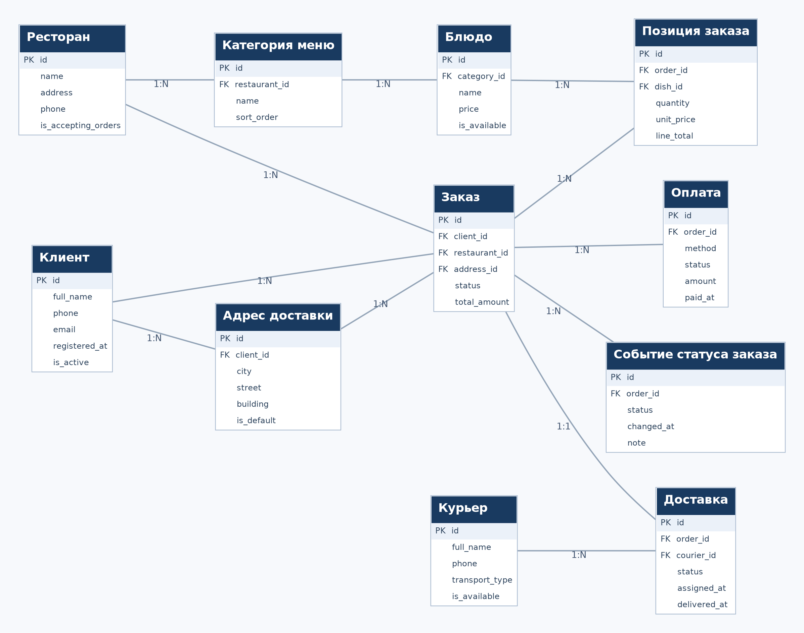

# Анализ и моделирование данных предметной области

**Лабораторная работа № 3. Вариант 3 — сервис доставки еды.**

## 1. Описание предметной области

**Название цифрового сервиса:** сервис заказа и доставки еды (обобщённая модель агрегатора ресторанов).

**Предметная область:** заказ блюд из ресторанов и доставка готовой еды клиентам.

**Назначение:** обеспечить клиенту выбор ресторана и блюд, оформление и оплату заказа, а ресторану и курьеру — выполнение заказа с возможностью отслеживания его состояния.

**Основные пользователи системы:**
- **Клиент** — просматривает меню, сохраняет адреса, оформляет и оплачивает заказы, следит за статусами.
- **Представитель ресторана** — поддерживает актуальность меню и доступности блюд, принимает заказ и отмечает этапы приготовления.
- **Курьер** — получает назначение, забирает заказ и отмечает этапы доставки.
- **Администратор сервиса** — контролирует работу ресторанов, заказов и доставок.

**Основные процессы:**
1. Регистрация клиента и ведение адресов доставки.
2. Управление ресторанами, категориями меню и блюдами.
3. Выбор блюд, формирование заказа и расчёт итоговой суммы.
4. Проведение оплаты и фиксация результата платёжной операции.
5. Подтверждение и приготовление заказа рестораном.
6. Создание доставки, назначение курьера и передача заказа.
7. Отслеживание текущего статуса и истории изменений заказа.

**Основные задачи информационной системы:**
- Хранить данные клиентов и их адресов доставки.
- Предоставлять каталог ресторанов и актуальное меню.
- Учитывать состав, стоимость и состояние заказов.
- Фиксировать попытки оплаты и их результаты.
- Назначать курьеров и отслеживать выполнение доставки.
- Хранить историю статусов для контроля и информирования клиента.

**Границы модели:** каждый заказ формируется из блюд **одного** ресторана; учёт прав доступа сотрудников, складских остатков, скидок и отзывов не рассматривается. Модель концептуальная: конкретная СУБД и таблицы не создаются.

## 2. Объекты данных

Выделено **11 объектов данных**, каждый из которых участвует в основных процессах.

### Клиент
**Назначение:** Человек, который выбирает блюда, указывает адрес доставки и оформляет заказы.

**Какая информация хранится:** id, full_name, phone, email, registered_at, is_active.

### Адрес доставки
**Назначение:** Сохранённое место, куда клиент может запросить доставку.

**Какая информация хранится:** id, client_id, city, street, building, apartment, entrance_note, is_default.

### Ресторан
**Назначение:** Заведение-партнёр, которое принимает и готовит заказы.

**Какая информация хранится:** id, name, address, phone, opening_hours, is_accepting_orders.

### Категория меню
**Назначение:** Раздел меню отдельного ресторана, объединяющий блюда по назначению.

**Какая информация хранится:** id, restaurant_id, name, sort_order.

### Блюдо
**Назначение:** Позиция меню, доступная для выбора клиентом.

**Какая информация хранится:** id, category_id, name, description, price, is_available.

### Заказ
**Назначение:** Обращение клиента на приготовление и доставку выбранных блюд из одного ресторана.

**Какая информация хранится:** id, client_id, restaurant_id, address_id, created_at, status, delivery_fee, total_amount, comment.

### Позиция заказа
**Назначение:** Конкретное блюдо и его количество в составе заказа; реализует связь заказов и блюд.

**Какая информация хранится:** id, order_id, dish_id, quantity, unit_price, line_total.

### Оплата
**Назначение:** Отдельная попытка оплаты заказа, включая её результат.

**Какая информация хранится:** id, order_id, method, status, amount, created_at, paid_at, transaction_reference.

### Курьер
**Назначение:** Исполнитель, которому можно назначить доставку.

**Какая информация хранится:** id, full_name, phone, transport_type, is_available.

### Доставка
**Назначение:** Операция получения заказа из ресторана и передачи клиенту.

**Какая информация хранится:** id, order_id, courier_id, status, assigned_at, picked_up_at, delivered_at.

### Событие статуса заказа
**Назначение:** Запись об изменении состояния заказа для истории и отслеживания.

**Какая информация хранится:** id, order_id, status, changed_at, note.

## 3. Атрибуты объектов

Для атрибутов используются логические типы «Строка», «Число», «Дата и время» и «Логическое». Числовые идентификаторы служат для связи объектов, а не для арифметических вычислений. Необязательные значения явно отмечены в описании.

### Клиент

| Атрибут | Тип данных | Описание |
|---|---|---|
| `id` | Число | Уникальный идентификатор клиента |
| `full_name` | Строка | Имя клиента для обращения и передачи заказа |
| `phone` | Строка | Контактный телефон; строка сохраняет знак «+» |
| `email` | Строка | Электронная почта для уведомлений (при наличии) |
| `registered_at` | Дата и время | Дата и время регистрации |
| `is_active` | Логическое | Признак действующей учетной записи |

### Адрес доставки

| Атрибут | Тип данных | Описание |
|---|---|---|
| `id` | Число | Уникальный идентификатор адреса |
| `client_id` | Число | Ссылка на владельца адреса |
| `city` | Строка | Населённый пункт |
| `street` | Строка | Улица |
| `building` | Строка | Дом и, при необходимости, корпус |
| `apartment` | Строка | Квартира или офис (необязательно) |
| `entrance_note` | Строка | Подъезд, этаж, домофон и комментарий курьеру |
| `is_default` | Логическое | Адрес по умолчанию в профиле клиента |

### Ресторан

| Атрибут | Тип данных | Описание |
|---|---|---|
| `id` | Число | Уникальный идентификатор ресторана |
| `name` | Строка | Наименование ресторана |
| `address` | Строка | Адрес точки приготовления и выдачи |
| `phone` | Строка | Телефон ресторана |
| `opening_hours` | Строка | Описание режима работы |
| `is_accepting_orders` | Логическое | Возможность принимать новые заказы сейчас |

### Категория меню

| Атрибут | Тип данных | Описание |
|---|---|---|
| `id` | Число | Уникальный идентификатор категории |
| `restaurant_id` | Число | Ресторан, которому принадлежит категория |
| `name` | Строка | Название раздела: пицца, напитки и т. п. |
| `sort_order` | Число | Порядок отображения категории в меню |

### Блюдо

| Атрибут | Тип данных | Описание |
|---|---|---|
| `id` | Число | Уникальный идентификатор блюда |
| `category_id` | Число | Категория, в которой размещено блюдо |
| `name` | Строка | Наименование блюда |
| `description` | Строка | Состав или краткое описание блюда |
| `price` | Число | Текущая стоимость одной порции |
| `is_available` | Логическое | Признак доступности блюда к заказу |

### Заказ

| Атрибут | Тип данных | Описание |
|---|---|---|
| `id` | Число | Уникальный номер заказа |
| `client_id` | Число | Клиент, оформивший заказ |
| `restaurant_id` | Число | Ресторан-исполнитель |
| `address_id` | Число | Выбранный адрес доставки |
| `created_at` | Дата и время | Момент оформления заказа |
| `status` | Строка | Текущий этап выполнения заказа из фиксированного списка |
| `delivery_fee` | Число | Стоимость доставки в рамках заказа |
| `total_amount` | Число | Общая сумма заказа: позиции плюс доставка |
| `comment` | Строка | Пожелания клиента (необязательно) |

### Позиция заказа

| Атрибут | Тип данных | Описание |
|---|---|---|
| `id` | Число | Уникальный идентификатор позиции |
| `order_id` | Число | Заказ, содержащий позицию |
| `dish_id` | Число | Выбранное блюдо |
| `quantity` | Число | Количество порций (положительное целое) |
| `unit_price` | Число | Цена порции на момент оформления заказа |
| `line_total` | Число | Стоимость позиции: количество × цена при заказе |

### Оплата

| Атрибут | Тип данных | Описание |
|---|---|---|
| `id` | Число | Уникальный идентификатор попытки оплаты |
| `order_id` | Число | Заказ, за который выполняется оплата |
| `method` | Строка | Способ оплаты из перечня разрешённых способов |
| `status` | Строка | Результат попытки оплаты |
| `amount` | Число | Сумма данной попытки оплаты |
| `created_at` | Дата и время | Когда создана попытка оплаты |
| `paid_at` | Дата и время | Время успешной оплаты (может отсутствовать) |
| `transaction_reference` | Строка | Ссылка на внешнюю платёжную операцию (при наличии) |

### Курьер

| Атрибут | Тип данных | Описание |
|---|---|---|
| `id` | Число | Уникальный идентификатор курьера |
| `full_name` | Строка | Имя курьера для связи и отображения |
| `phone` | Строка | Контактный телефон курьера |
| `transport_type` | Строка | Способ передвижения из допустимого списка |
| `is_available` | Логическое | Признак доступности для новых назначений |

### Доставка

| Атрибут | Тип данных | Описание |
|---|---|---|
| `id` | Число | Уникальный идентификатор доставки |
| `order_id` | Число | Заказ, для которого оформлена доставка |
| `courier_id` | Число | Назначенный курьер (до назначения может отсутствовать) |
| `status` | Строка | Этап доставки из фиксированного набора |
| `assigned_at` | Дата и время | Время назначения курьера (при наличии) |
| `picked_up_at` | Дата и время | Время получения заказа курьером (при наличии) |
| `delivered_at` | Дата и время | Фактическое время вручения (при наличии) |

### Событие статуса заказа

| Атрибут | Тип данных | Описание |
|---|---|---|
| `id` | Число | Уникальный идентификатор события |
| `order_id` | Число | Заказ, к которому относится событие |
| `status` | Строка | Значение статуса заказа после изменения |
| `changed_at` | Дата и время | Момент смены статуса |
| `note` | Строка | Пояснение причины изменения (при наличии) |

**Проверка полноты атрибутов.** Для клиентов и адресов определены контакты и реквизиты доставки; для меню — принадлежность ресторану и доступность блюд; для заказа — состав, цена и статус; для оплаты и доставки — результаты и время этапов. Поля `unit_price` и `delivery_fee` сохраняют цену на момент оформления, чтобы последующее изменение меню не меняло стоимость старых заказов.

## 4. Классификация данных

| Категория | Назначение | Пример |
|---|---|---|
| Текстовые | Хранение наименований, контактов, адресов и комментариев | `client.full_name`, `restaurant.address` |
| Числовые | Идентификаторы, количества, цены, суммы и порядок сортировки | `order_item.quantity`, `dish.price` |
| Даты и время | Фиксация моментов регистрации, заказа, оплаты и доставки | `order.created_at`, `delivery.delivered_at` |
| Логические | Признаки, принимающие значения «да/нет» | `dish.is_available`, `client.is_active` |
| Справочные | Значения из ограниченных перечней | `order.status`, `payment.method`, `courier.transport_type` |
| Вычисляемые | Результаты расчётов из других атрибутов | `order_item.line_total`, `order.total_amount` |

Ниже **каждый** атрибут отнесён к одной основной категории данных. Справочные значения технически могут храниться как строки, однако выделяются по их смыслу и ограниченному набору допустимых значений.

### Клиент

| Атрибут | Категория данных | Назначение / пояснение |
|---|---|---|
| `id` | Числовые | Уникальный идентификатор клиента |
| `full_name` | Текстовые | Имя клиента для обращения и передачи заказа |
| `phone` | Текстовые | Контактный телефон; строка сохраняет знак «+» |
| `email` | Текстовые | Электронная почта для уведомлений (при наличии) |
| `registered_at` | Даты и время | Дата и время регистрации |
| `is_active` | Логические | Признак действующей учетной записи |

### Адрес доставки

| Атрибут | Категория данных | Назначение / пояснение |
|---|---|---|
| `id` | Числовые | Уникальный идентификатор адреса |
| `client_id` | Числовые | Ссылка на владельца адреса |
| `city` | Текстовые | Населённый пункт |
| `street` | Текстовые | Улица |
| `building` | Текстовые | Дом и, при необходимости, корпус |
| `apartment` | Текстовые | Квартира или офис (необязательно) |
| `entrance_note` | Текстовые | Подъезд, этаж, домофон и комментарий курьеру |
| `is_default` | Логические | Адрес по умолчанию в профиле клиента |

### Ресторан

| Атрибут | Категория данных | Назначение / пояснение |
|---|---|---|
| `id` | Числовые | Уникальный идентификатор ресторана |
| `name` | Текстовые | Наименование ресторана |
| `address` | Текстовые | Адрес точки приготовления и выдачи |
| `phone` | Текстовые | Телефон ресторана |
| `opening_hours` | Текстовые | Описание режима работы |
| `is_accepting_orders` | Логические | Возможность принимать новые заказы сейчас |

### Категория меню

| Атрибут | Категория данных | Назначение / пояснение |
|---|---|---|
| `id` | Числовые | Уникальный идентификатор категории |
| `restaurant_id` | Числовые | Ресторан, которому принадлежит категория |
| `name` | Справочные | Название раздела: пицца, напитки и т. п. |
| `sort_order` | Числовые | Порядок отображения категории в меню |

### Блюдо

| Атрибут | Категория данных | Назначение / пояснение |
|---|---|---|
| `id` | Числовые | Уникальный идентификатор блюда |
| `category_id` | Числовые | Категория, в которой размещено блюдо |
| `name` | Текстовые | Наименование блюда |
| `description` | Текстовые | Состав или краткое описание блюда |
| `price` | Числовые | Текущая стоимость одной порции |
| `is_available` | Логические | Признак доступности блюда к заказу |

### Заказ

| Атрибут | Категория данных | Назначение / пояснение |
|---|---|---|
| `id` | Числовые | Уникальный номер заказа |
| `client_id` | Числовые | Клиент, оформивший заказ |
| `restaurant_id` | Числовые | Ресторан-исполнитель |
| `address_id` | Числовые | Выбранный адрес доставки |
| `created_at` | Даты и время | Момент оформления заказа |
| `status` | Справочные | Текущий этап выполнения заказа из фиксированного списка |
| `delivery_fee` | Числовые | Стоимость доставки в рамках заказа |
| `total_amount` | Вычисляемые | Общая сумма заказа: позиции плюс доставка |
| `comment` | Текстовые | Пожелания клиента (необязательно) |

### Позиция заказа

| Атрибут | Категория данных | Назначение / пояснение |
|---|---|---|
| `id` | Числовые | Уникальный идентификатор позиции |
| `order_id` | Числовые | Заказ, содержащий позицию |
| `dish_id` | Числовые | Выбранное блюдо |
| `quantity` | Числовые | Количество порций (положительное целое) |
| `unit_price` | Числовые | Цена порции на момент оформления заказа |
| `line_total` | Вычисляемые | Стоимость позиции: количество × цена при заказе |

### Оплата

| Атрибут | Категория данных | Назначение / пояснение |
|---|---|---|
| `id` | Числовые | Уникальный идентификатор попытки оплаты |
| `order_id` | Числовые | Заказ, за который выполняется оплата |
| `method` | Справочные | Способ оплаты из перечня разрешённых способов |
| `status` | Справочные | Результат попытки оплаты |
| `amount` | Числовые | Сумма данной попытки оплаты |
| `created_at` | Даты и время | Когда создана попытка оплаты |
| `paid_at` | Даты и время | Время успешной оплаты (может отсутствовать) |
| `transaction_reference` | Текстовые | Ссылка на внешнюю платёжную операцию (при наличии) |

### Курьер

| Атрибут | Категория данных | Назначение / пояснение |
|---|---|---|
| `id` | Числовые | Уникальный идентификатор курьера |
| `full_name` | Текстовые | Имя курьера для связи и отображения |
| `phone` | Текстовые | Контактный телефон курьера |
| `transport_type` | Справочные | Способ передвижения из допустимого списка |
| `is_available` | Логические | Признак доступности для новых назначений |

### Доставка

| Атрибут | Категория данных | Назначение / пояснение |
|---|---|---|
| `id` | Числовые | Уникальный идентификатор доставки |
| `order_id` | Числовые | Заказ, для которого оформлена доставка |
| `courier_id` | Числовые | Назначенный курьер (до назначения может отсутствовать) |
| `status` | Справочные | Этап доставки из фиксированного набора |
| `assigned_at` | Даты и время | Время назначения курьера (при наличии) |
| `picked_up_at` | Даты и время | Время получения заказа курьером (при наличии) |
| `delivered_at` | Даты и время | Фактическое время вручения (при наличии) |

### Событие статуса заказа

| Атрибут | Категория данных | Назначение / пояснение |
|---|---|---|
| `id` | Числовые | Уникальный идентификатор события |
| `order_id` | Числовые | Заказ, к которому относится событие |
| `status` | Справочные | Значение статуса заказа после изменения |
| `changed_at` | Даты и время | Момент смены статуса |
| `note` | Текстовые | Пояснение причины изменения (при наличии) |

**Примеры справочников:**
- `order.status`: `создан`, `подтверждён`, `готовится`, `готов`, `передан курьеру`, `доставлен`, `отменён`.
- `payment.method`: `карта онлайн`, `наличные при получении`; `payment.status`: `создана`, `успешна`, `отклонена`, `возвращена`.
- `delivery.status`: `ожидает назначения`, `назначена`, `забрана`, `в пути`, `вручена`, `отменена`.
- `courier.transport_type`: `пешком`, `велосипед`, `автомобиль`.
- `category.name`: справочное название раздела, настраиваемое внутри конкретного ресторана.

**Вычисляемые значения:**

`order_item.line_total = order_item.quantity × order_item.unit_price`

`order.total_amount = Σ(order_item.line_total по позициям заказа) + order.delivery_fee`

Итоговая стоимость рассчитана без скидок и чаевых, так как они находятся вне границ модели. Вычисляемые значения можно рассчитывать при обращении или сохранять как снимок суммы, обеспечив согласованность при обновлении позиций.

## 5. Связи между объектами

### Связь 1. Клиент — Адрес доставки
**Объект 1:** Клиент.  
**Объект 2:** Адрес доставки.  
**Тип связи:** 1:N.  
**Описание:** У одного клиента может быть несколько сохранённых адресов; каждый адрес принадлежит одному клиенту.

### Связь 2. Клиент — Заказ
**Объект 1:** Клиент.  
**Объект 2:** Заказ.  
**Тип связи:** 1:N.  
**Описание:** Клиент может оформить множество заказов; каждый заказ принадлежит одному клиенту.

### Связь 3. Адрес доставки — Заказ
**Объект 1:** Адрес доставки.  
**Объект 2:** Заказ.  
**Тип связи:** 1:N.  
**Описание:** Один сохранённый адрес может использоваться в нескольких заказах; каждый заказ указывает один адрес.

### Связь 4. Ресторан — Категория меню
**Объект 1:** Ресторан.  
**Объект 2:** Категория меню.  
**Тип связи:** 1:N.  
**Описание:** У ресторана есть несколько категорий меню; категория относится к одному ресторану.

### Связь 5. Категория меню — Блюдо
**Объект 1:** Категория меню.  
**Объект 2:** Блюдо.  
**Тип связи:** 1:N.  
**Описание:** Категория содержит несколько блюд; блюдо находится в одной категории.

### Связь 6. Ресторан — Заказ
**Объект 1:** Ресторан.  
**Объект 2:** Заказ.  
**Тип связи:** 1:N.  
**Описание:** Ресторан выполняет много заказов; в рамках модели один заказ относится к одному ресторану.

### Связь 7. Заказ — Позиция заказа
**Объект 1:** Заказ.  
**Объект 2:** Позиция заказа.  
**Тип связи:** 1:N.  
**Описание:** Заказ состоит из одной или нескольких позиций; каждая позиция принадлежит одному заказу.

### Связь 8. Блюдо — Позиция заказа
**Объект 1:** Блюдо.  
**Объект 2:** Позиция заказа.  
**Тип связи:** 1:N.  
**Описание:** Блюдо может встречаться в позициях разных заказов; одна позиция описывает одно блюдо.

### Связь 9. Заказ — Оплата
**Объект 1:** Заказ.  
**Объект 2:** Оплата.  
**Тип связи:** 1:N.  
**Описание:** Для заказа допускаются несколько попыток оплаты (например, после неуспешной); каждая попытка относится к одному заказу.

### Связь 10. Заказ — Доставка
**Объект 1:** Заказ.  
**Объект 2:** Доставка.  
**Тип связи:** 1:1.  
**Описание:** Один заказ имеет не более одной доставки; доставка относится к одному заказу и может ещё не быть создана.

### Связь 11. Курьер — Доставка
**Объект 1:** Курьер.  
**Объект 2:** Доставка.  
**Тип связи:** 1:N.  
**Описание:** Курьер может выполнять разные доставки; у одной доставки одновременно не более одного назначенного курьера.

### Связь 12. Заказ — Событие статуса заказа
**Объект 1:** Заказ.  
**Объект 2:** Событие статуса заказа.  
**Тип связи:** 1:N.  
**Описание:** Заказ имеет последовательность событий изменения статуса; каждое событие относится к одному заказу.

### Концептуальная связь M:N: Заказ — Блюдо

**Тип связи:** многие ко многим (M:N). Один заказ содержит несколько блюд, а одно блюдо может входить в разные заказы. Связь разрешена объектом **«Позиция заказа»**: `Заказ 1:N Позиция заказа` и `Блюдо 1:N Позиция заказа`. Это позволяет хранить количество и цену блюда именно в конкретном заказе.

**Ограничения согласованности:** адрес заказа должен принадлежать клиенту, оформившему его; блюда в заказе должны относиться к выбранному ресторану через категорию меню; `quantity > 0`, `price >= 0`, `delivery_fee >= 0`; до назначения курьера `delivery.courier_id` может быть пустым; для заказа предусмотрена не более чем одна запись «Доставка», но несколько попыток оплаты.

## 6. Концептуальная модель данных

ER-диаграмма отражает все **11 сущностей**, их ключевые атрибуты и **12 непосредственных связей** (а также смысловую связь M:N между заказом и блюдом через промежуточную сущность). Обозначения **1**, **N** и **1:1** указывают максимальную кратность; фактическое участие может быть необязательным для ещё не назначенной доставки или оплаты.

Редактируемый исходник: [`diagrams/food_delivery.drawio`](../diagrams/food_delivery.drawio). Увеличенная векторная версия: [`diagrams/food_delivery.svg`](../diagrams/food_delivery.svg).

## 7. Оценка качества исходных данных

### 1. Достаточно ли объектов выделено?
Да. Выделенные 11 объектов охватывают клиентов, адреса, рестораны и меню, состав заказа, оплату, назначение курьера, доставку и историю статусов. Основные процессы из раздела 1 отражены в модели.

### 2. Отсутствуют ли важные сущности?
Для заданной области существенных пропусков нет: отдельно предусмотрены **«Позиция заказа»**, **«Оплата»**, **«Доставка»** и **«Событие статуса заказа»**. В расширенной системе могут потребоваться «Сотрудник ресторана», «Складской остаток», «Акция/промокод», «Возврат средств» и «Оценка ресторана», однако они не нужны для моделирования указанных процессов в рамках данной работы.

### 3. Все ли необходимые атрибуты определены?
Да, для концептуального уровня. Предусмотрены идентификаторы и связи, контакты, цены, количество, текущие статусы и временные отметки. Для отслеживания доставки доступны статусы и фактическое время этапов. Поминутная GPS-геолокация, платёжные реквизиты и географические координаты в требования не входят.

### 4. Имеются ли дублирующиеся данные?
Необоснованное дублирование минимизировано: позиции заказа ссылаются на блюдо, блюда — на категорию, а категории — на ресторан. Контакты клиента и адрес хранятся отдельно. **Осознанно** сохранена `order_item.unit_price` наряду с `dish.price`: первое — историческая цена для заказа, второе — актуальная цена меню. Поля текущего статуса заказа и истории статусов тоже имеют разные роли: первое ускоряет отображение, второе хранит хронологию. Значения `line_total` и `total_amount` являются вычисляемыми и не должны независимо расходиться с исходными данными.

### 5. Достаточно ли информации для дальнейшего проектирования информационной системы?
Да. Сущности и их атрибуты определены, связи и кратности обозначены, справочники и вычисляемые показатели выделены, сформулированы ограничения согласованности. На этой основе можно перейти к логической модели, выбору первичных и внешних ключей, ограничениям уникальности и проектированию базы данных.

### Обнаруженные вопросы и внесённые уточнения
- **Изменение стоимости блюда:** добавлен `order_item.unit_price`, фиксирующий цену на момент заказа.
- **Повторные платежи:** связь «Заказ — Оплата» определена как 1:N, чтобы сохранять неудачные и повторные попытки.
- **Отслеживание исполнения:** добавлено «Событие статуса заказа» с датой изменения, а доставка вынесена в самостоятельную сущность.
- **Связь M:N:** введена «Позиция заказа», чтобы явно хранить количество и стоимость каждой выбранной позиции.

## Вывод

В ходе лабораторной работы проанализирована предметная область сервиса заказа и доставки еды. Определены 11 основных объектов, их назначение и атрибуты, проведена классификация текстовых, числовых, временных, логических, справочных и вычисляемых данных. Описаны связи 1:N, 1:1 и M:N, построена концептуальная ER-модель в draw.io. Выполнена проверка полноты, связности и отсутствия необоснованного дублирования; уточнения модели устраняют проблемы с изменением цен, повторными оплатами и хранением истории статусов. Полученный результат является основой для дальнейшего проектирования базы данных сервиса доставки еды.
